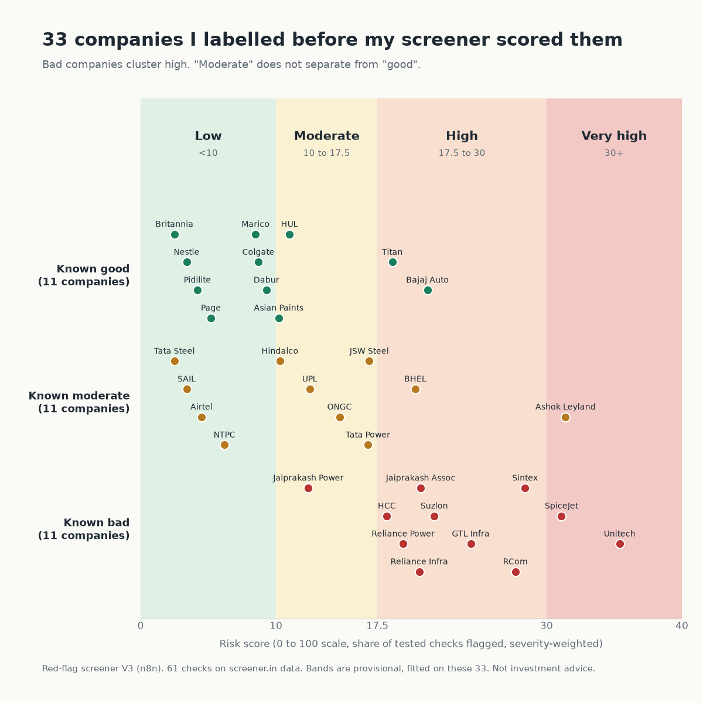

# Red-flag screener (n8n), V3

Paste up to 10 NSE/BSE tickers. This n8n workflow pulls 12 years of statements, 12 quarters and the shareholding pattern
for each company from screener.in, runs 61 checks (earnings quality, cash flow, working capital, leverage, returns,
margins, ownership, valuation and the latest quarter), turns the result into a 0 to 100 risk score, and downloads one
Excel file. Every check is marked FLAG, OK or Not tested, with the numbers behind it.

A flag means "look here first", not "this company is bad". The chart shows how the score bands were set: 33 companies
I labelled good, moderate or bad before scoring (see Calibration below).

## What V3 gives you
- **Watchlist mode**: up to 10 tickers per run (commas, spaces or new lines). It runs one company at a time with pauses, about 20 seconds each.
- **Risk score (0-100)**: the share of tested checks that are flagged, weighted High 3, Medium 2, Low 1. Checks that cannot be tested are left out and shown as "Checks tested %".
- **Bands**: under 10 Low, 10 to 17.5 Moderate, 17.5 to 30 High, 30+ Very high. Provisional, see Calibration.
- **One Excel file**: a Ranking sheet (riskiest first, top 3 flagged checks, change versus the last run) plus a detail sheet per company with section scores.
- **Failures stay visible**: a ticker that fails (bad symbol, bank, missing consolidated accounts, screener.in throttling) gets a row in Ranking with the reason and does not stop the others.

## Run it
1. Install and start n8n (https://docs.n8n.io/hosting/).
2. Create a new workflow, open `red-flag-screener-v3.n8n.json`, copy everything, paste (Ctrl+V) onto the canvas.
3. Click Execute workflow, open the Test URL of the "Watchlist form" node, enter tickers such as `HINDUNILVR, TITAN, SUZLON`, and submit.
4. The Excel downloads. Choose Standalone if a company has no consolidated accounts.

"Change vs last run" is stored in the workflow's static data, so it only persists once the workflow is published and run through the production form URL, not in test mode.

No API keys or credentials needed. The NSE pledge call is an unofficial endpoint and may change or block without notice.

## What it checks (61 checks)
Earnings quality (profit vs cash flow, other income, tax rate, EPS dilution), cash flow (free cash flow, financing
dependence, CWIP), working capital (debtor, inventory and payable days), leverage (debt/equity, interest cover,
borrowings vs profit), returns (ROCE, ROE, asset turnover) and margins and growth (44 checks, from V1), plus ownership
(promoter, FII, DII, public holding trends), valuation (P/B vs ROE, dividend sustainability, drawdown from 52-week high,
PEG) and latest-quarter checks (margin, profit, other income, sales slowdown vs a year ago), added in V2.
Four checks use extra sources: promoter pledge (NSE disclosure API), 5-year median P/E and 1-year price (screener.in
chart API), and peer P/E (screener.in peers API). If a source is down or blocked, only those checks show Not tested.

## Calibration (how the bands were set)
I picked 33 non-financial companies and labelled each good, moderate or bad before scoring anything
(`calibration-labels.json`, `calibration-labels-2.json`), then scored them with `node calibrate.js` (results in
`calibration-results*.json`). Median scores: good 8.7, moderate 12.5, bad 21.7.
- The earlier 15/30/50 bands matched my labels on 14 of 33. The 10 / 17.5 / 30 bands match 22 of 33.
- A score of 17.5 or more flags 10 of the 11 bad companies and falsely alarms on 4 of the 22 others (Titan, Bajaj Auto, BHEL, Ashok Leyland).
- "Moderate" does not separate cleanly from "good": the score works better as clean versus stressed than as three buckets.
- Small sample, cut-offs fitted to it, labels are my own judgment. Treat the bands as provisional. IOC and Vodafone Idea were left out because I had already used them while building.
- Some companies have no usable consolidated history on screener.in (Nestle, Page, Colgate, GTL Infra, ONGC). They score on Standalone, and the workflow tells you to retry with it.
- screener.in throttles fast requests (HTTP 429), so keep watchlists short and spaced out.

## Known limits
- Non-financial companies only. Banks, NBFCs and insurers are rejected, they need different checks.
- Individual check thresholds are my own judgment. Only the score bands were calibrated, and only on 33 companies.
- Data comes from screener.in's public pages and is parsed with regular expressions. The layout can change, data can be late or restated.
- Not tested = a data row is missing or the base value is zero or negative.
- Please check screener.in's terms of use before running this at volume. This project is not affiliated with screener.in. Use it for personal learning, a few lookups at a time.
- Not investment advice.

## Files
- `red-flag-screener-v3.n8n.json`: the workflow to import.
- `engine.js`: the 61 checks (the same code is embedded in the workflow's Code node).
- `score.js`: severity-weighted score, bands, ticker parsing, change versus last run.
- `xlsx-writer-v3.js`: dependency-free multi-sheet Excel writer.
- `build_workflow_v3.py`: regenerates the V3 workflow JSON from `engine.js`, `score.js` and `xlsx-writer-v3.js`.
- `test-v2.js`: threshold tests for the checks on synthetic pages (`node test-v2.js`).
- `test-v3.js`, `test-writer-v3.js`: tests for scoring and the Excel writer.
- `calibrate.js`, `calibration-*.json`: the labelled test set, the scoring script and its results.
- `run-test.js`: run the checks against live pages from the command line (`node run-test.js IOC IDEA`).

## Earlier versions
- **V2** (`red-flag-screener-v2.n8n.json`, `build_workflow.py`): one ticker per run, 61 checks, single-sheet Excel report. Example reports in `examples/` (`IOC-report.xlsx`, `VodafoneIdea-report.xlsx`) use this format.
- **V1** (`red-flag-screener-v1.n8n.json`): the original 44 annual checks.

Built by Aarav, a Class 12 student learning finance and automation. MIT licensed.
