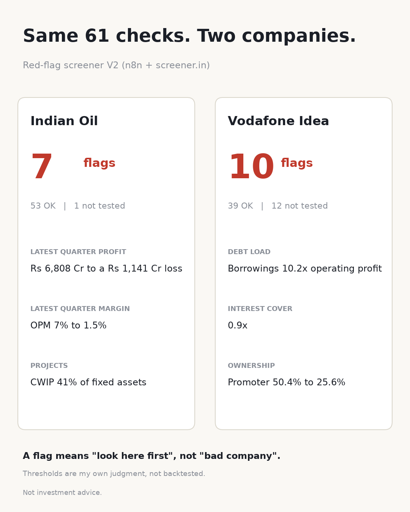

# Red-flag screener (n8n)

Type a ticker. This n8n workflow pulls 12 years of statements, 12 quarters and the shareholding pattern from screener.in,
runs 61 checks on earnings quality, cash flow, working capital, leverage, returns, margins, ownership, valuation
and the latest quarter, and downloads an Excel report. Every check is marked FLAG, OK or Not tested, with the numbers behind it.

A flag means "look here first", not "this company is bad". Example reports: `examples/IOC-report.xlsx` and `examples/VodafoneIdea-report.xlsx`.

## Run it
1. Install and start n8n (https://docs.n8n.io/hosting/).
2. Create a new workflow, open `red-flag-screener-v2.n8n.json`, copy everything, paste (Ctrl+V) onto the canvas.
3. Click Execute workflow, open the Test URL of the "Ticker form" node, and enter an NSE/BSE symbol such as `IOC`.
4. The Excel downloads. Choose Standalone if a company has no consolidated accounts.

No API keys or credentials needed. The NSE pledge call is an unofficial endpoint and may change or block without notice.

## What it checks (V2, 61 checks)
Earnings quality (profit vs cash flow, other income, tax rate, EPS dilution), cash flow (free cash flow, financing
dependence, CWIP), working capital (debtor, inventory and payable days), leverage (debt/equity, interest cover,
borrowings vs profit), returns (ROCE, ROE, asset turnover), margins and growth (44 checks, unchanged from V1), plus
V2's ownership (promoter, FII, DII, public holding trends), valuation (P/B vs ROE, dividend sustainability, drawdown
from 52-week high, PEG) and latest-quarter checks (margin, profit, other income, sales slowdown vs a year ago).
Four checks use extra sources: promoter pledge (NSE disclosure API), 5-year median P/E and 1-year price (screener.in
chart API), and peer P/E (screener.in peers API). If a source is down or blocked, only those checks show Not tested.
V3 will add the sector switch and text-based checks from the annual report.

## Known limits
- Non-financial companies only. Banks, NBFCs and insurers are rejected, they need different checks.
- Thresholds are my own judgment, not backtested.
- Data comes from screener.in's public pages and is parsed with regular expressions. The layout can change, data can be late or restated.
- Not tested = a data row is missing or the base value is zero or negative.
- Please check screener.in's terms of use before running this at volume. This project is not affiliated with screener.in. Use it for personal learning, a few lookups at a time.
- Not investment advice.

## Files
- `red-flag-screener-v2.n8n.json`: the workflow to import (`-v1` is the earlier 44-check version).
- `engine.js`: the 61 checks (the same code is embedded in the workflow's Code node).
- `test-v2.js`: threshold tests for the V2 checks on synthetic pages (`node test-v2.js`).
- `run-test.js`: run the checks against live pages from the command line (`node run-test.js IOC IDEA`).
- `build_workflow.py`: regenerates the workflow JSON from `engine.js`.

Built by Aarav, a Class 12 student learning finance and automation. MIT licensed.
